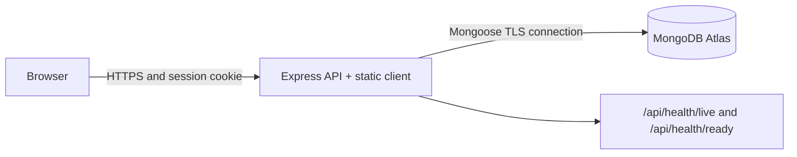

# ApartCheck

ApartCheck is an Asset and Ticket accountability ledger for one residential Society. It records what shared infrastructure exists, where it is, who owns the next action, what textual and photo completion proof was submitted, and whether an Administrator verified the work.

The shipped workflow covers Administrator setup and recovery, Units, Members, shared Assets, protected QR lookup, role boundaries, session invalidation, and the complete internal Ticket lifecycle with assigned Technician completion photos and immutable evidence attempts. It is not a multi-property platform, vendor system, notification service, or analytics product.

## Architecture



The client and API ship from one Render web service. `APP_BASE_URL` is the
canonical public origin for origin checks and generated QR links.

## Stack

| Layer        | Technology                                                           |
| ------------ | -------------------------------------------------------------------- |
| UI           | React 19, Vite, React Router, Tailwind CSS                           |
| API          | Node 22.12, Express 5, TypeScript                                    |
| Data         | MongoDB, Mongoose, MongoDB Atlas in production                       |
| Security     | HttpOnly sessions, JWT, bcrypt, Helmet, origin and rate-limit guards |
| Verification | Vitest, Supertest, Playwright, axe-core, ESLint, Prettier            |
| Deployment   | Render Blueprint and GitHub Actions                                  |

## Local Setup

Prerequisites: Node `22.12.0`, npm, and MongoDB with replica-set support. Local
transactions require replica-set support; standalone MongoDB is not supported.
Copy `.env.example` to `server/.env`, then set a `JWT_SECRET` with at least 32
characters and a reachable `MONGODB_URI`. Keep `TRUST_PROXY_HOPS=0` locally.

```bash
npm ci
docker run --name apartcheck-mongo --detach --publish 27017:27017 mongo:8 --replSet rs0 --bind_ip_all
docker exec apartcheck-mongo mongosh --eval 'rs.initiate({_id: "rs0", members: [{_id: 0, host: "localhost:27017"}]})'
cp .env.example server/.env
npm run dev
```

Atlas alternative: create an M0 cluster and database user, then set
`MONGODB_URI` to Atlas's TLS URI with its replica-set options. Atlas clusters
provide replica-set support by default. Do not use a standalone local URI,
because bootstrap and society mutations rely on transactions.

Open `http://localhost:5173`. The first visit reports bootstrap status. Submit
society name, owner-admin email, and password once. Bootstrap creates exactly
one society and first admin in a transaction; later bootstrap attempts are
rejected. Generated credentials from user creation or reset are displayed once
in the admin handoff and are not persisted as plaintext.

With the template's blank Cloudinary values, local development uses bounded
in-memory image storage. Local photo data is lost when the server stops. Production
requires the three Cloudinary server credentials listed below.

For a production-like process:

```bash
npm run build
npm run start -w server
```

## Environment Contract

| Variable                | Required   | Meaning                                                                       |
| ----------------------- | ---------- | ----------------------------------------------------------------------------- |
| `NODE_ENV`              | No         | `development`, `test`, or `production`; defaults to development               |
| `PORT`                  | No         | HTTP port; Render sets this, local default is `3000`                          |
| `MONGODB_URI`           | Yes        | MongoDB connection URI                                                        |
| `JWT_SECRET`            | Yes        | Session signing secret, minimum 32 characters; use random production material |
| `APP_BASE_URL`          | Yes        | Browser origin used by origin guard and QR URLs                               |
| `TRUST_PROXY_HOPS`      | No         | Trusted proxy count; use `0` locally and `1` behind Render                    |
| `VITE_API_TARGET`       | E2E only   | API target for the Vite dev proxy                                             |
| `E2E_SERVER_PORT`       | E2E only   | Ephemeral API port used by Playwright setup                                   |
| `CLOUDINARY_CLOUD_NAME` | Production | Cloudinary cloud name for authenticated Ticket Evidence storage               |
| `CLOUDINARY_API_KEY`    | Production | Cloudinary API key for authenticated Ticket Evidence storage                  |
| `CLOUDINARY_API_SECRET` | Production | Cloudinary API secret; keep it in the deployment secret store                 |

Never commit `.env`, Atlas URIs, passwords, Cloudinary credentials, or JWT secrets. Render values
marked `sync: false` are entered in the service dashboard.

Ticket Evidence uploads are authenticated and server-mediated. ApartCheck authorizes
evidence reads and streams image bytes through the same-origin endpoint with
`Cache-Control: private, no-store`; Cloudinary signed URLs are internal storage-adapter
details and never enter Ticket or browser cache state. Each photo is limited to 8 MiB,
each upload request to five photos, and each request to 40 MiB total.

The checked-in `render.yaml` sets `TRUST_PROXY_HOPS=1` for Render's single
trusted proxy, so rate limiting uses the client IP rather than the proxy IP.

## Tests And CI

Unit and integration tests use `MongoMemoryReplSet` with one replica-set
member. This matters because bootstrap and society mutations use MongoDB
transactions; a standalone MongoDB process would produce false failures or
false confidence. Test setup creates the replica set, synchronizes indexes,
clears collections between tests, and stops it afterward.

Run local gates in CI order:

```bash
npm ci
npm run format:check
npm run lint
npm run typecheck
npm test
npm run build
npx playwright install --with-deps chromium
npm run test:e2e
npm run test:a11y
```

`test:e2e` runs the Phase 1 flow and the Ticket photo-evidence flow in one
Playwright invocation. Run `test:a11y` afterward, not concurrently: both suites
own frontend port `5173`. E2E and accessibility server setup injects ephemeral
MongoDB and fake image storage, so these browser checks do not contact
Cloudinary or require Cloudinary credentials. The Ticket flow verifies that the browser
uses the same-origin binary endpoint rather than a direct provider URL.

GitHub Actions runs this sequence on pushes and pull requests. It uploads the
Playwright report only when E2E or accessibility checks fail.

## Recovery

Owner-admin recovery requires database access and prints one generated
temporary password. The plaintext exists only during this terminal handoff:

```bash
npm run recover:admin -w server -- admin@example.com
```

The command re-enables the matching admin, rotates its password and session
version, and exits nonzero without credentials when recovery fails. Deliver the
temporary password out of band, sign in, and change it immediately. Forced
password change blocks resource routes until completed. Password reset and
account disable invalidate older sessions.

## Render Deployment

`render.yaml` defines one free Node web service. It runs `npm ci --include=dev
&& npm run build`, starts `npm run start -w server`, uses
`/api/health/ready` for health checks, and declares Node `22.12.0`. Render may
cold-start the free service; the first request can take longer while the process
and Atlas connection wake.

Render/Atlas provisioning, Cloudinary credential setup, and public URL/browser
acceptance are external follow-up. This task does not claim live Cloudinary
delivery or deployment verification for the photo-evidence workflow.

1. Create an Atlas M0 cluster, a dedicated database user restricted to the
   ApartCheck database, and a TLS URI. Add the service-specific CIDR ranges from
   Render's **Connect > Outbound** view to Atlas Network Access.
2. Create a Render service from `render.yaml`.
3. Set `MONGODB_URI`, a cryptographically random `JWT_SECRET` of at least 32
   bytes, and the final Render origin as `APP_BASE_URL`.
4. Add `CLOUDINARY_CLOUD_NAME`, `CLOUDINARY_API_KEY`, and
   `CLOUDINARY_API_SECRET` through Render's secret configuration. Never put their
   values in the repository or browser. Uploads are authenticated and server-mediated;
   authorized image reads return same-origin `private, no-store` bytes while any
   Cloudinary signed URL remains internal to the server adapter.
5. Deploy the committed revision and wait for the health check to pass.
6. Export the actual origin and verify it:

```bash
export APARTCHECK_URL=https://YOUR-SERVICE.onrender.com
curl --fail --silent --show-error "$APARTCHECK_URL/api/health/live"
curl --fail --silent --show-error "$APARTCHECK_URL/api/health/ready"
curl --fail --silent --show-error "$APARTCHECK_URL/login"
```

Expected health responses are `{"status":"ok"}`; login must return HTML.
Complete bootstrap, create one asset, scan its printed QR from a phone, and
confirm resident read-only access at 360 px. Do not record a URL as verified
until these checks pass.

**Public URL verification:** external follow-up; no live URL or Cloudinary
photo delivery is claimed by this task.

## Ticket Workflow

The Phase 2 client and API implement a complete Society-scoped maintenance Ticket path: a Resident or Administrator reports a Unit issue, an Administrator assigns one Technician and sets a zero-through-five photo requirement, the Technician records work, uploads completion photos while work is active, and submits a textual completion summary, and an Administrator verifies or returns the work. Each lifecycle mutation appends immutable Ticket history; submitted photo sets remain visible as immutable attempts with textual outcomes. Evidence uploads enforce an 8 MiB per-photo limit, a five-photo limit, and a 40 MiB total request limit.

Automated local coverage exercises the full Resident → Administrator → Technician → Administrator lifecycle, including returned and verified photo attempts, with fake image storage through the same-origin binary endpoint. Live Cloudinary delivery and role-by-role acceptance remain unverified until Task 5 succeeds.

## Later direction

- Vendors, costs, PDFs, comments, and richer media evidence beyond Ticket completion photos
- SLA and due-date policy, notifications, analytics, exports, and integrations
- Multiple societies per owner and cross-property administration
- Offline scanning, native mobile clients, and production observability
- Backups, retention policy, and paid scaling
